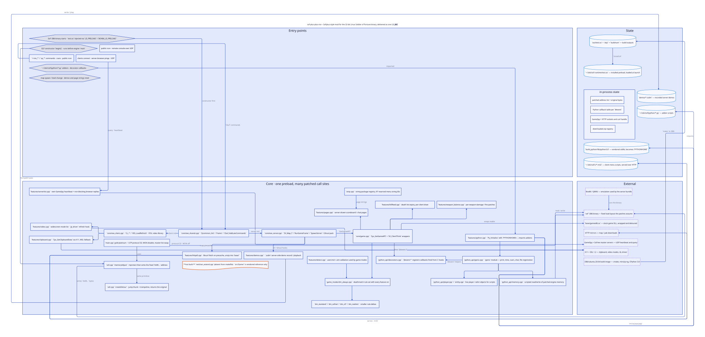

# sof-plus-plus-nix — for humans

> SoFplus-style server and client mod for the 32-bit Linux Soldier of Fortune binary, shipped as a single `LD_PRELOAD` shared object that patches the stock executable in memory.

Read it left to right:

- **The mod is a preload, not a rebuild** — `test.so` is injected with `LD_PRELOAD` (or `BOX86_LD_PRELOAD` in the server bundle) and its ELF constructor runs *before* the engine's `main`. Everything after that is `memoryAdjust` / `callE8Patch` writing to hardcoded `0x08…` addresses plus `createDetour` jump thunks, which is why it only works with the exact 1.07f binary layout it was mapped against.
- **One patch pass buys the modern server** — `main.cpp` upgrades protocol 32 → 33, NOPs the dead WON client/server objects, swaps the master-list call for its own, and relaxes the checksum/violence gates. Those byte edits, not a new engine, are what "1.07f compatible" and "working server list" mean here.
- **Python is baked in, not optional plumbing** — CPython 3.8 is statically linked into the `.so` and `PYTHONHOME=.` points at the `sof-runtime` folder, so `~/.loki/sof/python/*.py` addons and the vendored stdlib travel together. Addons only see the engine through the `ppnix`, `ent`, `player` and `event` modules, and `@event.*` is just a registration call that the C hooks fire later.
- **Two features reach the network, for different reasons** — `httpdl` uses libcurl on `svc_precache` to pull maps and paks plus `.m32` menu scripts into the game dir, while `serverlist` speaks GameSpy itself (heartbeat + query) and answers the browser without blocking the frame. That replaced a master server that no longer exists.
- **The Docker i386 image is the real toolchain** — host multilib builds fight static `libstdc++`, `minizip-ng` and `libpython3.8.a`, so `dock-build.sh` builds `i386/ubuntu:20.04` (cmake, minizip, Python) and `dock-run.sh` mounts `src/obj/hdr/out`. `USE_PYTHON=0` / `USE_DEMOSYSTEM=0` drop the Python surface and the `.ssdm` demo writer; the build number is linked in with `--defsym` so each `.so` reports its own version.

Source: [`docs/system.d2`](docs/system.d2). Edit that, then run [`scripts/render-diagram.sh`](scripts/render-diagram.sh).
