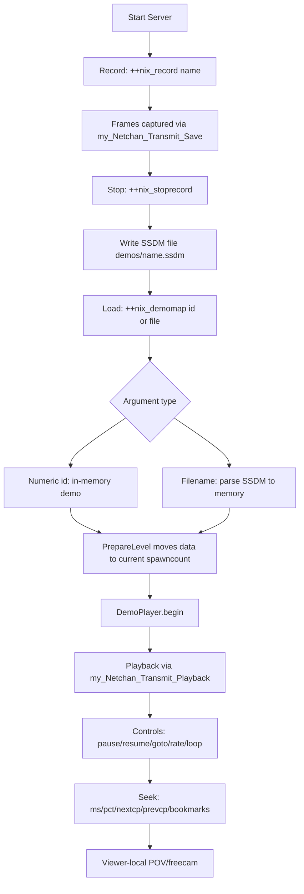

## Server‑Side Demos (POC)

This document describes the minimal server‑side demo system implemented in this codebase: how to record, save, load, and control playback from the server, plus the on‑disk container format (SSDM).

### Quick start

1) Enable the feature (e.g. in dedicated server config):

```
set _++nix_serverside_demos 1
```

2) Record a session and save it

```
+ +nix_record mymatch
# play for a while
+ +nix_stoprecord
```

When stopping, the server writes a file: `demos/mymatch.ssdm` and prints a numeric in‑memory id (spawncount). You can play from memory by id or later load from disk.

3) Play back

```
# from memory by id (printed when you stopped recording)
+ +nix_demomap <id>

# OR from file (extension and path default to demos/*.ssdm)
+ +nix_demomap mymatch
+ +nix_demomap demos/mymatch.ssdm
```

4) List in‑memory demos

```
+ +nix_match_history
```

### Playback controls

- Pause/Resume
  - `++nix_demo_pause`
  - `++nix_demo_resume`
- Frame navigation
  - `++nix_demo_goto <frame>`: set current frame
  - `++nix_demo_rate <step>`: advance by N frames each tick (e.g. 2 = fast‑forward)
  - `++nix_demo_loop`: toggle looping at end of demo
- Seeking by time/percentage
  - `++nix_demo_seekms <ms>`: seek to the checkpoint at or before the given time in ms; if none, estimate at ~50ms/frame
  - `++nix_demo_seekpct <0-100>`: seek to the given percentage of demo length; prefers nearest checkpoint ≤ target
- Checkpoints
  - `++nix_demo_nextcp`: jump to next checkpoint after current frame
  - `++nix_demo_prevcp`: jump to previous checkpoint before current frame
- Bookmarks
  - `++nix_demo_bmset <name>`: save current frame as bookmark
  - `++nix_demo_bmgoto <name>`: jump to bookmark
  - `++nix_demo_bmlist`: list bookmarks
  - `++nix_demo_bmdel <name>`: delete bookmark
  - `++nix_demo_bmren <old> <new>`: rename bookmark

Optional POV
- `++nix_demo_pov <slot|-1>`: select a recorded slot’s perspective; `-1` = first available slot
- `++nix_demo_pov_next` / `++nix_demo_pov_prev`: cycle to the next/previous recorded slot at the current frame
- `demo_pov <slot|-1>` (viewer-local): spectator adjusts only their own POV during shared playback
- `demo_pov_next` / `demo_pov_prev` (viewer-local): cycle POV only for that viewer

Free camera
- `++nix_demo_freecam <0|1>`: toggle experimental freecam mode (see note below)
- `demo_freecam <0|1>` (viewer-local): toggle freecam for your own viewer
- `demo_pov_auto <ms>` (viewer-local): auto-cycle POV every N milliseconds (0 to disable)
- Roadmap: a freecam spectator mode that ignores recorded POV and allows manual movement. Two options:
  - Server‑synthesized freecam: server runs a spectator entity for the viewer and sends view packets decoupled from any slot.
  - Client local freecam: minimal server data, client ignores POV and renders using local camera controls. This is simpler but may require client modding.

### How it works

- Recording
  - Outgoing network data per frame and per client slot is captured via the server’s `Netchan_Transmit` hook, in `DemoRecorder::saveNetworkData`, into `DemoData::demo_frames_map`.
  - When recording ends (`++nix_stoprecord`), a compact container file is written (`demos/<name>.ssdm`).

- Loading
  - `++nix_demomap <id>` selects a previously recorded in‑memory demo (spawncount id) for playback.
  - `++nix_demomap <file>` parses an SSDM file from disk, stages it in memory, then starts playback.

- Playback
  - On map change, `DemoSystem::PrepareLevel()` moves the chosen `DemoData` under the current `spawncount` and calls `DemoPlayer::begin()`.
  - Per‑frame playback is injected via a `Netchan_Transmit` hook (`my_Netchan_Transmit_Playback`), which sends recorded un/reliable chunks to connected clients. Pause/seek/loop are respected.

### SSDM file format (version 1)

All integer fields are little‑endian 32‑bit unless noted. Strings are length‑prefixed.

1. Magic (5 bytes): `SSDM1`
2. Metadata
   - level_name (len + bytes)
   - deathmatch (u32)
   - game_dir (len + bytes)
3. Frame range
   - first_frame (u32)
   - last_frame (u32)
4. Checkpoints
   - checkpoint_count (u32)
   - Repeated checkpoint_count times:
     - frame (u32)
     - timestamp_ms (u32)
5. Frames
   - frame_count (u32)
   - Repeated frame_count times:
     - frame (u32)
     - slot_count (u32)
     - Repeated slot_count times:
       - slot (u32)
       - rel_len (u32), rel_bytes (rel_len bytes)
       - unrel_len (u32), unrel_bytes (unrel_len bytes)

Notes
- The container is intentionally simple for rapid iteration and testing.
- Order of frames is preserved on disk and in memory.
- Reader/writer robustness:
  - Reader validates fields and sizes; zero‑initializes `sizebuf_t` and sets `cursize` accordingly.
  - Writer emits rel/unrel payloads only if `cursize > 0`.
  - Disk‑loaded demos are staged under a temporary id (e.g. `-2`) and moved to the current `spawncount` on `PrepareLevel()`, erasing the temp key.

### Design map



### Tips and limitations

- Enable with `_++nix_serverside_demos 1` before recording or playing.
- In‑memory demos are keyed by `spawncount`. `++nix_match_history` shows those with captured frames.
- Ghoul chunk replay is optional; if none recorded, playback skips that phase.
- Checkpoints improve seek accuracy; if none exist yet, time‑based seek uses a conservative estimate (~50ms/frame).
- On‑demand activation: if a connecting viewer has no `activation_chunks`, the server synthesizes them (serverdata/configstrings/baselines) from the latest checkpoint ≤ current time and sends them as unreliable packets before frames.

### Roadmap / Ideas

- Compression of rel/unrel payloads (zlib) in SSDM
- Auto‑checkpoint every N seconds/frames
- SSDM validator/repair tool and metadata index
- Export to client‑side demo format


### Robustness and Dota 2‑style Live Shared Replay

The goal is to make server‑side demos resilient and multi‑viewer friendly, approaching the UX of a shared live replay: multiple clients connect to the same demo, join in progress, seek, pause/resume, and stay in sync. Below are concrete techniques tailored to the Quake 2 engine and to this codebase’s implementation.

- **Core objectives**
  - **Join‑in‑progress**: new viewers can join a currently playing demo and quickly catch up to the session time without desyncs.
  - **Single authoritative timeline**: one server‑controlled playback clock that all viewers follow; per‑viewer variance handled via catch‑up/skip.
  - **Reliable state rebase**: periodic full/undelta frames (“sync points”) so deltas never reference unknown bases for newly joined or lagging viewers.
  - **Per‑viewer perspective**: each viewer chooses a recorded slot to watch; switching POV is instant and does not affect others.

- **Checkpoints and sync frames (delta‑neutralization)**
  - Use `DemoCheckpoint` to capture and index “sync points” at fixed cadence (e.g., every 1–2 seconds or every N frames):
    - `svc_serverdata` + all `svc_configstring` + all `svc_spawnbaseline` for the then‑current map state.
    - Optionally, an immediate undelta `svc_frame` snapshot so the next frame after a checkpoint can delta from −1; otherwise ensure the next recorded frame is undelta.
  - Implementation hooks already mapped in this repo:
    - Generation path: `DemoCheckpoint::generate_svc_serverdata` assembles `svc_serverdata/configstrings/baselines` from server memory.
    - Trigger path: set `cl->lastframe = -1` for all active slots around a checkpoint to force undelta frames in the next tick.
  - Storage/indexing:
    - Persist `checkpoints` in `DemoData` keyed by frame number; include timestamp and optional file offset for SSDM.
    - Maintain a frame‑to‑checkpoint index to seek to the nearest ≤ target frame/time in O(log n).

- **Join‑in‑progress flow (multi‑viewer, Dota 2‑style)**
  - On viewer connect while a demo is playing:
    1) Send the latest checkpoint ≤ current playback time: `svc_serverdata`, configstrings, baselines via `activation_chunks[slot]`.
    2) Begin streaming frames starting at `checkpoint_frame + 1` for the chosen POV.
    3) Apply a temporary per‑viewer catch‑up rate (e.g., `frame_step = 2–8`) until viewer reaches the session’s `current_frame`, then normalize to `1`.
  - If a viewer falls far behind (netlag/backpressure), skip them ahead to the next checkpoint rather than replaying a huge backlog.
  - If no ghoul data was recorded, skip ghoul phase (already handled by `DemoPlayer::playback`). If present, send ghoul chunks before frames and track per‑viewer `ghoulChunkIndex[slot]`.

- **Playback timeline and synchronization**
  - Maintain a single authoritative `current_frame` for the session in `DemoPlayer`; it advances by wall‑clock (server ticks) and respects `pause`, `rate`, `loop`, `goto`.
  - Keep per‑viewer state for things that must diverge, e.g., ghoul progress, `watch_slot`, and short‑term catch‑up `frame_step`.
  - Commands should address either the session (affects all viewers) or a single viewer:
    - Session: `++nix_demo_pause/resume`, `++nix_demo_rate`, `++nix_demo_goto`, `++nix_demo_loop`.
    - Viewer: `++nix_demo_pov <slot>`, `++nix_demo_catchup <rate>`, or auto catch‑up.

- **Packetization, MTU and rate control (Quake 2 netchan)**
  - Respect ~1400‑byte payload budget; fragment activation payloads into `chunk_t` pages (existing). Keep a margin for headers.
  - Prefer unreliable datagrams for demo frame payload to avoid reliable channel stalls; only use reliable for small critical control messages.
  - Implement per‑viewer send budgeting based on Quake 2 `rate`/`cl_maxfps` heuristics; throttle burst sends during catch‑up.
  - Backpressure strategy:
    - If viewer’s outgoing queue grows beyond a threshold, reduce per‑viewer `frame_step` to 1 and, if still behind, jump them to the next checkpoint.

- **Delta safety and desync prevention**
  - Ensure frames right after checkpoints are undelta so clients don’t reference unknown `deltaframe`s.
  - During normal playback, recorded `svc_frame` messages should reference the immediately previous serverframe in the stream. Starting a viewer at a checkpoint guarantees the delta base exists locally.
  - If an out‑of‑order/loss condition is detected (viewer missed too much), resync by replaying the latest checkpoint instead of attempting to re‑encode deltas.

- **Storage, indexing and GC**
  - SSDM v2 proposal (backward compatible when possible):
    - Per‑frame index at file tail: {frame -> file offset}, {checkpoint -> offset} for fast random seek.
    - Optional compression of rel/unrel payloads (zstd/zlib) with per‑chunk CRC32.
    - Metadata block: map name, game dir, tick rate, capture start time, wall‑clock timestamps per frame delta (optional).
  - Memory management:
    - Keep only a sliding window of frames in memory during live playback; spill older frames to SSDM and evict with LRU.
    - Cap in‑memory demos by count/age; expose `++nix_match_history` with sizes and eviction marks.

- **Security and permissions**
  - Gate demo control commands to server operators (rcon/flag) and ensure spectators cannot affect the live server.
  - Avoid unsafe `svc_stufftext`; where used, restrict to benign commands (e.g., `allow_download 0`, preload hints).
  - Sanitize file paths when loading `.ssdm`.

- **Compatibility and export**
  - Provide `++nix_demo_export_dm2` to emit standard Quake 2 `.dm2` for legacy tools, acknowledging that advanced features (multi‑POV, checkpoints) won’t map 1:1.
  - Offer a compact “POV‑only” export for highlights/clips.

- **Operational tooling**
  - `++nix_demo_validate <file>`: SSDM integrity (magic, sizes, CRCs, index), prints summary and first/last frames.
  - `++nix_demo_repair <in> <out>`: best‑effort salvage on truncated/corrupt SSDM.
  - `++nix_demo_index <file>`: builds/repairs the tail index without rewriting payloads.

- **Live relay architecture options**
  - Quake 2 runs a single map per server. To stream a match live while it’s running:
    - Option A (recommended): run a lightweight “replay server” process that reads frames from shared memory/IPC or tail‑follows an SSDM being written by the match server, then serves viewers on a `serversidedemo` map. Commands:
      - `++nix_relay_start <port>` on the replay server
      - `++nix_relay_attach <remote_host:port|file|spawncount>` to follow a live feed or a file
    - Option B (single process): multiplex two virtual sessions in one process and synthesize netchan for replay viewers. This is invasive and brittle in Q2; not advised beyond prototyping.

- **Testing and QA**
  - Determinism: fixed‑seed playback drift tests across OS/builds.
  - Network adversity: simulated 5–20% packet loss, 200–400ms jitter; verify join‑in‑progress and auto resync behavior.
  - Long‑haul: 60–120 minute recordings, measure memory/IO pressure and GC.

- **Short‑term tasks (concrete)**
  - Implement auto‑checkpoint every N seconds/frames with global `cl->lastframe = -1` arm/disarm and store in `DemoData::checkpoints`.
  - Add per‑viewer state (POV, catch‑up rate) instead of global in `DemoPlayer`.
  - Introduce session index (frame -> checkpoint id, file offset if from SSDM) for O(1) or O(log n) seeks.
  - Throttle/catch‑up policy: detect lagging viewers and jump them to next checkpoint.
  - SSDM v2: optional zstd compression, per‑chunk CRC, tail index; keep v1 reader for backward compatibility.
  - CLI: `++nix_demo_seekms`, `++nix_demo_seekpct`, `++nix_demo_nextcp`, `++nix_demo_prevcp`, `++nix_demo_bm*` (bookmarks) — wire to `DemoPlayer` controls.

### Behavioral details (current implementation)

- Recording
  - Capture point: server `Netchan_Transmit` wrapper saves outgoing rel/unrel bytes per frame and per slot into `DemoData::demo_frames_map[frame][slot]`.
  - Only fully connected clients are recorded (`cs_spawned`).
  - Rel/unrel payloads are copied into fresh `sizebuf_t` buffers with proper `cursize`.

- Activation and handshake
  - `DemoCheckpoint::generate_svc_serverdata(int slot, std::vector<chunk_t>&)` synthesizes `svc_serverdata`, all `svc_configstring`, and `svc_spawnbaseline` messages into paged `chunk_t`s (≈1400 bytes) for a given slot.
  - On connect in playback, if `activation_chunks[slot]` is empty, the server generates them on‑demand from the latest checkpoint ≤ current demo time and sends them first.

- Playback frame selection
  - `DemoPlayer.current_frame` is the authoritative session frame; advances by server ticks (respecting pause/loop/rate).
  - Per‑viewer POV:
    - Viewer’s `watch_slot` is honored if present for the frame; otherwise falls back to the smallest recorded slot id.
    - If viewer’s `watch_slot` is `-1`, the smallest recorded slot id is used.
  - Payload preference: unrel > rel; if neither exists for that perspective, the server advances by `frame_step` and tries next.

- Viewer‑local commands (handled in `my_ClientCommand`)
  - `demo_pov <slot|-1>`, `demo_pov_next`, `demo_pov_prev`
  - `demo_pov_auto <ms>` auto‑cycles viewer POV every N milliseconds
  - `demo_freecam <0|1>` toggles a flag (streaming to be implemented)

- Global server controls
  - As documented in Playback controls (`++nix_demo_*` commands).

- Memory and cleanup
  - `DemoData` destructor frees all activation/ghoul `chunk_t` buffers and rel/unrel arrays in `demo_frames_map`.
  - When moving disk‑loaded data to the current `spawncount`, the temp key is erased.

### Engine interception points (Quake II)

These are the canonical hook points in the Quake II server for recording, playback, join‑in‑progress, and synchronization. The names below map to wrappers implemented in this codebase (prefixed `my_…`) and their original engine counterparts (`orig_…`).

- **Map/server lifecycle**
  - **`SV_SpawnServer` → `my_SV_SpawnServer`**: Called on map start/change. Captures `svs.spawncount`, resets `DemoSystem`, moves selected `DemoData` under current spawncount, and starts playback via `DemoPlayer::begin()` when `++nix_demomap` is requested.
  - Related init: **`Qcommon_Init` → `my_Qcommon_Init`**, **`Cbuf_AddLateCommands` → `my_Cbuf_AddLateCommands`** to register commands and cvars.

- **Client connect/handshake**
  - **`SV_New_f` → `my_SV_New_f`**: Post‑handshake stage. Lets the engine perform the normal connect sequence, then flips `demo_player->packet_override = true` so the transmit path can inject demo payloads for that client.
  - Earlier entry points (optional): `SVC_DirectConnect`, `SV_ConnectClient` for steering viewers into demo mode before full spawn (not required for current POC).

- **Authoritative per‑frame clock**
  - **`SV_RunGameFrame` → `my_SV_RunGameFrame`**: Server tick. Use as the session clock to advance `DemoPlayer::current_frame`, apply `pause/rate/goto/loop`, and schedule auto‑checkpoints.

- **Outgoing network path (save and playback)**
  - **`Netchan_Transmit` → `my_Netchan_Transmit_Save`**: During recording, captures outgoing per‑slot payloads each frame and stores them under `DemoData::demo_frames_map[frame][slot]`.
  - **`Netchan_Transmit` → `my_Netchan_Transmit_Playback`**: During playback, if `demo_player->active` and `packet_override` are set, routes data to `DemoPlayer::playback` to send activation chunks (serverdata/configstrings/baselines), optional ghoul chunks, then per‑frame unrel payloads.
  - Auxiliary: **`SV_SendClientDatagram` → `my_SV_SendClientDatagram`** can be used to coordinate reliable vs unreliable splitting and to enforce undelta on the frame after a checkpoint.
  - Note: **`SV_WriteFrameToClient`** is the builder for `svc_frame`; instrumenting it gives precise control over delta vs undelta and is recommended for robust checkpoints (present but not required in the current POC).

- **Message serialization (synthesizing activation)**
  - **`MSG_Write*` and `MSG_WriteDeltaEntity`**: Used in `DemoCheckpoint::generate_svc_serverdata` to construct `svc_serverdata`, all `svc_configstring`, and `svc_spawnbaseline` messages that rebase a newly connected viewer’s state.

- **Client message parsing (undelta arm/disarm)**
  - **`SV_ExecuteClientMessage` → `my_SV_ExecuteClientMessage`**: Safe place to set `cl->lastframe = -1` to force the next `svc_frame` to be undelta after creating a checkpoint or when switching POV. Alternatively, do this immediately before sending in `SV_SendClientDatagram`.

- **SOF‑specific content staging**
  - **`GhoulPackReliable`/`GhoulPack`/`GhoulReliableHitwire` → `my_*`**: Capture and replay ghoul data. During playback, send ghoul chunks during activation before frames and track per‑viewer progress with `ghoulChunkIndex[slot]`.

- **Hook installation (where detours are applied)**
  - `main.cpp`: detours for `SV_RunGameFrame`, `SV_SpawnServer`, `SV_New_f`, and call‑site patches for `SV_SendClientDatagram` and `SV_ExecuteClientMessage`.
  - `cvars.cpp`: call‑site patches that insert `my_Netchan_Transmit_Save` (record) and `my_Netchan_Transmit_Playback` (playback) into the transmit path.

- **Cheat‑sheet mapping (current codebase)**
  - `SV_SpawnServer` → `src/core/exe_server.cpp` (`my_SV_SpawnServer`) ⇒ `DemoSystem::PrepareLevel()`
  - `SV_New_f` → `src/core/exe_server.cpp` (`my_SV_New_f`) ⇒ sets `demo_player->packet_override`
  - `SV_RunGameFrame` → `src/core/exe_server.cpp` (`my_SV_RunGameFrame`) ⇒ session clock
  - `SV_SendClientDatagram` → `src/features/netchan_extend.cpp` and `src/core/exe_server.cpp` hooks
  - `Netchan_Transmit` (save/playback) → `src/core/exe_shared.cpp` (`my_Netchan_Transmit_Save` / `my_Netchan_Transmit_Playback`)
  - `SV_ExecuteClientMessage` → `src/core/exe_server.cpp` (`my_SV_ExecuteClientMessage`) ⇒ optional undelta arm
  - `MSG_Write*`, `MSG_WriteDeltaEntity` → `src/features/demos.cpp` (`DemoCheckpoint::generate_svc_serverdata`)
  - Ghoul hooks → `src/core/exe_server.cpp` (`my_GhoulPack*`, `my_GhoulReliableHitwire`)

Implementation notes
- Prefer `Netchan_Transmit` interception for portable capture/playback; use `SV_SendClientDatagram`/`SV_WriteFrameToClient` to manage delta safety and reliable/unreliable boundaries.
- For join‑in‑progress, drive activation via `DemoCheckpoint::generate_svc_serverdata`, then stream frames; apply a per‑viewer catch‑up `frame_step` until aligned with the session `current_frame`.

### Troubleshooting, difficulties, limitations

- **Viewer stuck at black screen / never spawns**
  - **Likely causes**: activation chunks not sent; `packet_override` not set; playback not active; no checkpoint available.
  - **Checks**:
    - Ensure `_++nix_serverside_demos 1` is set before use.
    - Use `++nix_demomap <id|file>` to trigger `serverstate_trigger_play` → map change → `DemoPlayer.begin()`.
    - Verify `my_SV_New_f` ran and `demo_player->packet_override` is true for the connecting viewer.
    - Confirm `activation_chunks[slot]` are non‑empty at first playback step.
  - **Fixes**:
    - Add auto‑checkpoints; on viewer connect, send latest checkpoint (serverdata/configstrings/baselines) before frames.
    - Force next frame undelta by setting `cl->lastframe = -1` post‑checkpoint.

- **“no in‑memory demo id” when using `++nix_demomap <id>`**
  - **Cause**: the requested `spawncount` was not recorded in this process or has been evicted.
  - **Fixes**: list available demos with `++nix_match_history`; or load from disk: `++nix_demomap demos/<name>.ssdm`.

- **“unsupported demo file” when loading**
  - **Cause**: not an `SSDM1` file, truncated/corrupt, or wrong path.
  - **Fixes**: check extension/path; re‑record; prefer relative `demos/<file>.ssdm`. Plan: use a validator tool to check magic/sizes/CRCs.

- **Choppy playback / stutter**
  - **Likely causes**: oversized activation packets; reliable channel stalls; viewer backpressure; rate mismatch.
  - **Fixes**:
    - Keep chunks under ~1400 bytes; fragment activation (`chunk_t`) with headroom.
    - Prefer unreliable payloads for frames; keep reliable only for small control.
    - Implement per‑viewer send budget; if queue grows, reduce `frame_step` to 1 and, if needed, jump viewer to next checkpoint.
    - Align server tick and demo step; avoid overly high frame rates.

- **Desync or wrong POV frames**
  - **Causes**: missing undelta after checkpoint; `watch_slot` not present in a frame.
  - **Fixes**:
    - Always force an undelta frame immediately after a checkpoint.
    - When `watch_slot` is absent, fall back to `begin()->second` (first available slot) rather than erroring.

- **Crashes / memory growth**
  - **Causes**: leaked `chunk_t` buffers; accumulating frames with no GC; large multi‑hour demos kept in RAM.
  - **Fixes**:
    - Ensure destructors free activation/ghoul and per‑slot buffers (already implemented in `DemoData::~DemoData`).
    - Add LRU for `demos` and a sliding window for live playback; spill older frames to SSDM.

- **Packet drops / “dumped unreliable”**
  - **Causes**: payloads exceed MTU; bursts exceed client rate.
  - **Fixes**: keep demo datagrams under ~1200–1300 bytes; throttle sends; spread activation across multiple ticks.

- **Playback stops at the end and does not loop**
  - **Cause**: `loop` is false.
  - **Fix**: `++nix_demo_loop` toggle; or auto‑rewind on end.

- **Hook/patch fragility across builds**
  - **Causes**: address changes in different Q2 binaries/OSes.
  - **Fixes**: move to signature scanning for hook install; add startup self‑checks and fail fast with clear log output.

- **Current limitations**
  - SSDM v1 lacks compression and a tail index; random seek is O(n) and storage is larger.
  - Join‑in‑progress depends on periodic checkpoints; if spacing is too wide, catch‑up is slower.
  - Demo is network‑byte accurate, not a sim re‑execution; freecam and non‑recorded perspectives are not available.
  - Live relay currently requires running the demo playback server separately; a single‑process multiplexer is not advised for stability.

- **Recommended diagnostics**
  - Enable verbose logs; look for `SOFPPNIX_DEBUG` lines from: `my_SV_New_f`, `DemoPlayer::begin`, `DemoPlayer::playback` (frame numbers), and activation sending.
  - Verify hooks are active at startup (detour success messages); if not, rebuild with correct addresses/patterns.
  - Sanity‑check `first_frame`, `current_frame`, `final_frame` on playback start.


